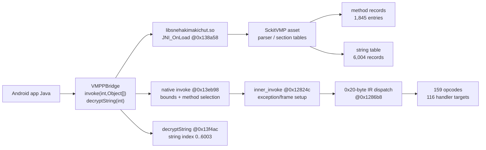

# SckitVMP Research

**Static reconstruction of a packed Android VM and its managed/native bridge.**

[Read the disclaimer first](DISCLAIMER.md). This is independent research, not an
official project or an endorsement by any vendor, application developer, or
government body. No vendor authorization is claimed.

## 1. Project status and scope

This repository is a **sanitized research release** of a completed Phase VI–XI
investigation. It documents the static structure of the `SckitVMP` container,
the recovered string encoding, the method-record layout, the native
`libsnehakimakichut.so` execution pipeline, and the observed Android runtime
behavior of one preserved application build.

The release deliberately does **not** include the third-party APK, DEX files,
native libraries, the VMP asset, packet captures, screenshots, device logs, or
full extracted inventories. Those inputs remain private and are not
redistributed. Selected derived tables and checksums are included so the
analysis can be evaluated without republishing proprietary binaries or raw
personal/environmental data.

What is established:

- a reproducible structural parser for the container format (when a lawfully
  obtained matching input is supplied);
- the XOR/modified-UTF-8 string encoding and the class/method record layout;
- the distinction between method-table IDs and VM opcodes;
- the native bridge/registration and inner-invoke/dispatch addresses;
- an address-level opcode-handler table (159 opcodes, 116 unique handlers);
- observed 500/root, 900/Frida, and 300/VPN behavior and activation UI context.

What is **not** established:

- the exact detector predicate or method for the 500/900/300 outcomes;
- a complete method-payload-to-opcode decoder;
- the exact activation protocol, backend schema, or `STATUS: ONLINE` meaning;
- TLS application payloads or a complete detector map.

## 2. Table of contents

1. [Project status and scope](#1-project-status-and-scope)
3. [Executive summary](#3-executive-summary)
4. [Research motivation and questions](#4-research-motivation-and-questions)
5. [Project history: Phases VI–XI](#5-project-history-phases-vixi)
6. [Research environment and toolchain](#6-research-environment-and-toolchain)
7. [Methodology](#7-methodology)
8. [Architecture overview](#8-architecture-overview)
9. [SckitVMP container reconstruction](#9-sckitvmp-container-reconstruction)
10. [String decoding](#10-string-decoding)
11. [Method records and code offsets](#11-method-records-and-code-offsets)
12. [Managed-to-native bridge and pipeline](#12-managed-to-native-bridge-and-pipeline)
13. [IR dispatch and opcode inventory](#13-ir-dispatch-and-opcode-inventory)
14. [Detection observations](#14-detection-observations)
15. [Activation-flow analysis](#15-activation-flow-analysis)
16. [Network forensics and TLS limitations](#16-network-forensics-and-tls-limitations)
17. [Evidence confidence levels](#17-evidence-confidence-levels)
18. [Repository tree and file guide](#18-repository-tree-and-file-guide)
19. [Prerequisites and environment setup](#19-prerequisites-and-environment-setup)
20. [Reproduction instructions](#20-reproduction-instructions)
21. [Automated tests and validation](#21-automated-tests-and-validation)
22. [Known limitations and unresolved questions](#22-known-limitations-and-unresolved-questions)
23. [Intellectual-property and redistribution](#23-intellectual-property-and-redistribution)
24. [Responsible-research scope and disclaimers](#24-responsible-research-scope-and-disclaimers)
25. [Contributing](#25-contributing)
26. [Security reporting](#26-security-reporting)
27. [Future work](#27-future-work)
28. [Acknowledgments and third-party tools](#28-acknowledgments-and-third-party-tools)
29. [License explanation](#29-license-explanation)
30. [Final status and report links](#30-final-status-and-report-links)

## 3. Executive summary

The investigation began with observed behavior, not with a source tree. A
preserved Android build displayed environment-dependent gates:

- a rooted device produced **Error Code 500 / Root Detected**;
- a Frida-instrumented run produced **Error Code 900 / Frida Detected**;
- a PCAPdroid VPN run produced **Error Code 300 / VPN Detected**.

The subsequent work separated the application's Java bridge, the native
`libsnehakimakichut.so` runtime, and the `SckitVMP` asset. Phase XI reconstructed
the container as an 8-byte `SckitVMP` header, six `(offset, count)` section
descriptors, two reserved words, a method-code region, and six data sections. It
then recovered the string transform: each encoded byte is XORed with
`(byte_index & 0xA3)` and decoded as modified UTF-8. All 6,004 string records in
the preserved asset decode, with their UTF-16 length hints matching.

The method table contains 1,845 records. `VMPPBridge.invoke(id)` is a **method
selector** into that table, not an opcode. In particular, `invoke(1839)` maps to
`LoginDialog$100000002.run`, the animation callback already identified in the
earlier phases. The native `invoke` stub at `0x13eb98` bounds-checks the ID and
calls `inner_invoke` at `0x12824c`; 0x20-byte IR records are dispatched through a
tag table at `0x10b660` and a 159-entry relative jump table at `0x108ff0`. The
table resolves to 116 unique handler targets.

The most important limitation is equally clear: the 16-byte method-code record
header and 724 method-ID matches are confirmed, but the variable payload after
the header has not been decoded into the IR opcode stream. The detection
predicates behind 500/900/300, the `Please don't try to crack me!!!` exception,
`RcIsRooted`, and the activation protocol remain unresolved. The repository
therefore publishes a verified structural/native model, not a claimed complete
detector bypass or activation implementation.

## 4. Research motivation and questions

The project asked:

1. Can a packed Android VM's container be reconstructed from its native parser
   and a preserved asset without executing modified production software?
2. Are the managed invocation IDs opcodes, record offsets, or method selectors?
3. How do method records, code records, and the native interpreter relate?
4. Can the observed root/Frida/VPN outcomes be attributed to a specific VMP
   method, native function, or predicate?
5. What can activation call sites establish without a key or server access?
6. Which conclusions are observations, correlations, interpretations, or
   unresolved hypotheses?

The answers are intentionally bounded. A method mapping is not a detector map; a
temporal network correlation is not causation; a string name is not proof of a
predicate.

## 5. Project history: Phases VI–XI

The public reports preserve phase identity. Earlier phases I–V established the
target provenance, the APK/DEX inventory, the embedded engine artifacts, and the
runtime harness. Phases VI–XI produced the native/VMP focus documented here.

| Phase | Objective | Methods | Principal results | Unresolved at phase end |
|---|---|---|---|---|
| VI | Native/VMP baseline | Ghidra, JADX, Frida, string bridge | Shield loader/JNI paths, `isPmsHooked` @ `0x165e48`, VMP library structure, string-bridge behavior | Exact root/Frida method; full VMP semantics |
| VII | Detection inventory | Static API scans, runtime A/B, owned fixture | Root/Frida/PMS/PairIP/activation layers separated; 1839 correction began | Detector implementation; signature/tamper paths |
| VIII | Unrooted differential | Unrooted device, permission flow, fixture validation | Root gate absent on unrooted run; VIP dialog reached; 1839 confirmed as animation callback | Exact detector; activation key |
| IX | Network/VPN/activation | tcpdump, PCAPdroid, `ss`, DNS/SNI correlation | App traffic before root error; VPN 300 observed; Firebase/API context | TLS payloads; causality; activation schema |
| X | Call-site inventory | DEX regex/AST inventory, categories | 607 app sites + 117 log sites; 62 classes; 1839 retained as callback | Native record/opcode mapping; detector IDs |
| XI | Binary reconstruction | Ghidra, parser, table extraction, tests | Container sections, XOR/mutf8 strings, 1,845 method records, 724/724 code-ID matches, 159/116 dispatch table | Method payload decoder; exact predicates; activation protocol |

Phase XI corrected two earlier presentation errors without altering the private
historical records: the six header pairs are `(offset, count)` rather than
`(offset, length)`, and the first string length is a decoded UTF-16-unit count,
not a byte length. The Phase X manifest's stale hashes for two inventories and
its executive summary are documented in [the Phase X audit](reports/phase11/phase10_audit.md).

## 6. Research environment and toolchain

| Component | Version/use |
|---|---|
| Linux x86_64 | Analysis host |
| Python | 3.14.8 (standard library only for public scripts) |
| Ghidra | 12.2 PUBLIC, headless |
| Java | OpenJDK 27 |
| `llvm-objdump` | 23.1.3 |
| JADX | 1.5.6 (private Phase VI–X work) |
| Rizin | 0.9.1 (private native inspection) |
| Android runtime | Two private test devices, Android 15/API 35 and Android 16/API 36 |
| Frida | 17.24.3 (private runtime observation) |

The toolchain was used read-only against the preserved third-party artifacts.
No APK, DEX, native library, or VMP asset is included in this repository.

## 7. Methodology

The project uses four evidence classes:

1. **Static observation** — bytes, offsets, strings, ELF/Java structures, and
   decompiled control flow. Reproducible from a lawfully obtained matching input.
2. **Runtime observation** — behavior recorded on private test devices. Cited as
   observation, not as a universal implementation.
3. **Correlation** — two observed events (for example, DNS/TCP before a UI error)
   are placed on a timeline. Correlation does not prove causation.
4. **Hypothesis/interpretation** — a mechanism that fits evidence but lacks a
   demonstrated predicate or path. It is labelled PROBABLE/UNRESOLVED.

The public data favors structural evidence. Runtime evidence is summarized with
device/environment details removed. See [methodology](docs/methodology.md) and
[limitations](docs/limitations.md).

## 8. Architecture overview



Addresses are Ghidra addresses with image base `0x100000`; subtract `0x100000`
for ELF-relative addresses. The diagram separates confirmed paths from the
unresolved method-payload decoder. See [architecture](docs/architecture.md).

## 9. SckitVMP container reconstruction

The recovered top-level layout for the preserved 562,963-byte asset is:

| Offset | Meaning |
|---:|---|
| `0x00` | 8-byte `SckitVMP` magic |
| `0x08` | six `(u32 offset, u32 count)` pairs |
| `0x38` | two reserved u32 (zero in the preserved sample) |
| `0x40` | method-code region start |
| section 0 | 6,004 variable-length strings |
| section 1 | 677-entry class table |
| section 2 | 353 exception-type vectors |
| section 3 | 937 three-word reference records |
| section 4 | 1,845 five-word method records |
| section 5 | 22,118-byte blob; role unresolved |

The exact offsets and spans are in
[vmp_format_reconstruction.md](reports/phase11/vmp_format_reconstruction.md).
Section 5 is explicitly **not** called bytecode: no method-code offset points
into it, and no consumer was demonstrated.

## 10. String decoding

Each string record is:

```text
uleb128 decoded UTF-16 code units
uleb128 encoded byte length
encoded bytes
```

Native `FUN_001313f4` was shown to XOR byte `i` with `i & mask`; the VMP string
call uses mask `0xA3` at ELF `0x38fc4` / Ghidra `0x138fc4`. The result is decoded
as modified UTF-8. In the preserved asset, all **6,004/6,004** records decode and
all decoded UTF-16 unit counts match the first field.

The full decoded string inventory is intentionally withheld because it contains
third-party application text and implementation details. Public examples are
limited to structural descriptors, the documented UI/status strings, and the
selected method records needed to reproduce the findings.

## 11. Method records and code offsets

Each of the 1,845 section-4 records has five u32 fields:

| Field | Interpretation | Status |
|---:|---|---|
| 0 | class-table index | CONFIRMED |
| 1 | method-name string index | CONFIRMED |
| 2 | exception-vector index, `0xffffffff` = none | CONFIRMED |
| 3 | auxiliary value | OBSERVED; semantics unresolved |
| 4 | method-code record offset, 0 = no code | CONFIRMED |

Method record index is the `invoke` ID. **724/724** non-zero code offsets point
to a record whose first u32 equals the method ID. The code header is 16 bytes:
method ID, a flag-bearing word, a packed register/`ins`-like word, and an
instruction-count-like word. The variable payload after the header is not
decoded; the opcode-sequence mapping is therefore unresolved.

Selected records are published in
[data/method-record-excerpt.csv](data/method-record-excerpt.csv); the full
inventory remains private.

## 12. Managed-to-native bridge and pipeline

The Java bridge declares native `invoke(int,Object[])`, `decryptString(int)`,
`initApp`, `initApp2`, and `decrypt(byte[])`. The preserved native registration
table contains four entries:

- `invoke` at `0x13eb98`;
- an initialization body at `0x13f0a0` used by two registration slots;
- `decryptString` at `0x13f4ac`.

`invoke` uses JNI array accessors, bounds-checks the ID against 1,845, performs a
hash lookup, selects method metadata with a `0x40`-byte stride, and calls
`inner_invoke`. The method ID is not an opcode. `decryptString` indexes a
separate string vector (`0..6003`) and returns a Java string.

The public crosswalk is an **excerpt**:
[data/managed-native-crosswalk-excerpt.csv](data/managed-native-crosswalk-excerpt.csv).
Full call-site inventories are private. See
[native_execution_pipeline.md](reports/phase11/native_execution_pipeline.md) and
[native_callgraph.md](reports/phase11/native_callgraph.md).

## 13. IR dispatch and opcode inventory

`inner_invoke` consumes 0x20-byte IR records. The opcode field is selected by a
tag-dependent offset table at Ghidra `0x10b660`; the opcode (1..159) indexes the
relative jump table at `0x108ff0`, dispatched at `0x1286b8`. The table was
extracted to [data/opcode_dispatch.csv](data/opcode_dispatch.csv): **159 opcode
entries, 116 unique handler addresses**. Seven-opcode families (50–56, 57–63,
64–70, 71–77, 78–84, 85–91) and a partial 92/93/94/96 family are documented.

This is an address-level mapping. No opcode is assigned a Java operation name
without direct evidence. Handler 50–56 performs JNI object-array access
(`GetArrayLength`/`GetObjectArrayElement`), supporting an object-array handler
family description, not a complete `invoke-*` naming. See
[opcode_mapping.md](reports/phase11/opcode_mapping.md).

## 14. Detection observations

The following are **observed outcomes**, not a complete detector map:

| Observation | Status |
|---|---|
| Rooted-device run: Error Code 500 / Root Detected | CONFIRMED behavior |
| Frida-instrumented run: Error Code 900 / Frida Detected | CONFIRMED behavior |
| PCAPdroid VPN run: Error Code 300 / VPN Detected | CONFIRMED behavior |
| `invoke(1839)` = `LoginDialog$100000002.run` animation callback | CONFIRMED mapping |
| `Please don't try to crack me!!!` under Frida at 1839/1744 | CONFIRMED exception; cause unresolved |
| `RcIsRooted` Bundle field | UNRESOLVED |
| `isPmsHooked` at `libScKitShieldV1` `0x165e48` | CONFIRMED static implementation, separate library |
| Exact root/Frida/VPN predicates and VMP IDs | UNRESOLVED |

The decoded VMP table contains root/status UI text (`This Device is rooted!`,
`STATUS:`, `ONLINE`, `OFFLINE`) but no exact `Root Detected`, `Frida Detected`,
`VPN Detected`, `Please don't try to crack me!!!`, or `RcIsRooted` literal. The
VMP `inner_invoke` security-controlled branch is a **candidate** gate, not a
proven detector. See [detection_correlation.md](reports/phase11/detection_correlation.md).

## 15. Activation-flow analysis

The activation UI obtains `Settings.Secure.ANDROID_ID` and uses a Firebase RTDB
base URL whose project-specific identifier is withheld from this release. The
recovered method records include `fetch` (1744), `verify` (1765),
`pushDeviceId` (1756), `pushExpiryDate` (1764), `chkExp` (1665), `hasNet` (1641),
and `offlineOk` (1685), owned by `LoginDialog$NetTask` or `LoginDialog`.

This establishes call ownership and UI context only. It does not establish the
request path/schema, key semantics, response fields, `STATUS: ONLINE` meaning, or
post-activation behavior. No key was guessed, forged, or used; no production
server was manipulated. See
[activation_network_context.md](reports/phase11/activation_network_context.md).

## 16. Network forensics and TLS limitations

Private runtime captures showed the app resolving and connecting to a
public-sector attendance API host and a Firebase RTDB endpoint during startup.
The app sockets were attributed to the target process at capture time. The
temporal order places those connections before the observed root-error page, but
does **not** prove that a server response caused the root decision.

Exact IP addresses, capture timestamps, device identifiers, PIDs/UIDs, raw
packets, and project-specific Firebase identifiers are withheld. SNI/host
metadata was visible; TLS application payloads and certificates were not
decrypted. No certificate pinning bypass, CA installation, or proxy was used.
See [network_forensics.md](reports/phase9/network-forensics.md).

## 17. Evidence confidence levels

| Level | Meaning in this repository |
|---|---|
| CONFIRMED | Reproduced from bytes/structure or directly observed runtime behavior; cited. |
| PROBABLE | Supported by converging evidence but no complete predicate/path. |
| CORRELATED | Events share a timeline/context; causation is not established. |
| UNRESOLVED | Not enough evidence; retained as an explicit question. |

Examples: the container layout and string decoder are CONFIRMED from the asset
and native code; the 1839 method mapping is CONFIRMED; the 500/900/300
predicates are UNRESOLVED; network timing is CORRELATED. See
[findings](docs/findings.md).

## 18. Repository tree and file guide

```text
.
├── README.md
├── DISCLAIMER.md
├── CONTRIBUTING.md
├── SECURITY.md
├── .gitignore
├── docs/
│   ├── overview.md
│   ├── methodology.md
│   ├── architecture.md
│   ├── phase-history.md
│   ├── findings.md
│   ├── limitations.md
│   ├── reproduction.md
│   ├── ethics-and-scope.md
│   └── publication-audit.md
├── reports/
│   ├── phase6/            sanitized native/VMP baseline
│   ├── phase7/            sanitized detection inventory
│   ├── phase8/            sanitized differential/VMP reports
│   ├── phase9/            sanitized network/VPN report
│   ├── phase10/           sanitized call-site report
│   └── phase11/           reconstructed format/pipeline/crosswalk reports
├── data/
│   ├── opcode_dispatch.csv
│   ├── method-record-excerpt.csv
│   ├── managed-native-crosswalk-excerpt.csv
│   ├── private-source-hashes.json
│   ├── public-evidence-summary.json
│   └── public-files.json
├── scripts/phase11/       parser and opcode-table extractor
├── tests/                 self-contained public tests
└── examples/minimal-vmp/  synthetic boundary example
```

Full raw reports, inventories, logs, screenshots, captures, APKs, DEX files,
libraries, VMP assets, and extracted application strings are **not** in this
tree. They remain private; see [publication audit](docs/publication-audit.md).

## 19. Prerequisites and environment setup

The public checks require only:

- Python 3.10+ (tested with 3.14);
- Git;
- a POSIX shell.

No Ghidra, JADX, Frida, Android device, or proprietary input is required for the
public tests. The full parser can be exercised only if you independently and
lawfully obtain a matching VMP asset and native library; those files are not
provided here.

```bash
# from a local checkout of the verified repository
cd sckit-vmp-research
python3 --version
```

Do not download the proprietary application or libraries from unauthorized
sources. The analysis documents the exact preserved hashes so a lawful holder
can verify an independently obtained copy; it does not provide a download path.

## 20. Reproduction instructions

Self-contained checks:

```bash
python3 -m unittest discover -s tests -v
python3 scripts/check_public_release.py
```

Parse the synthetic boundary example:

```bash
python3 scripts/phase11/vmp_format.py examples/minimal-vmp/minimal.vmp
```

If you have a matching lawful VMP input, the parser and tests can be pointed at
it with an environment variable; see [reproduction](docs/reproduction.md). The
native opcode extractor requires the matching `libsnehakimakichut.so`; the
repository includes the expected table shape in `data/opcode_dispatch.csv` but
not the library.

Every command in this README corresponds to a script or test in the repository.
The private runtime/device experiments cannot be reproduced without the private
captures and an authorized test environment; they are documented as
observations, not as public commands.

## 21. Automated tests and validation

The private project's final Phase XI run was:

- Phase XI: **24 tests, 24 passed**;
- combined private suite: **117 tests run, 115 passed, 2 skipped, 0 failed**.

The public release is intentionally smaller and does not contain the
proprietary inputs. Its current local result is **14 tests run, 14 passed, 0
skipped, 0 failed** (`python3 -m unittest discover -s tests -v`). The public
checks validate the synthetic container, string primitives, opcode CSV shape,
documentation links, data schemas, and the absence of excluded
binary/secret material. The audit is in
[publication audit](docs/publication-audit.md).

## 22. Known limitations and unresolved questions

- The 16-byte method-code payload has not been decoded into the 0x20-byte IR; no
  method ID has a complete opcode sequence.
- The 22,118-byte section-5 blob and 937 reference records have no proven
  consumer.
- The exact 500/900/300 predicates and the anti-crack exception throw site are
  unresolved.
- `RcIsRooted` has no confirmed producer/consumer.
- Activation request/response, `STATUS: ONLINE`, and post-activation behavior are
  unresolved without an authorized key/account.
- TLS application payloads and certificate details were unavailable.
- The Phase X manifest has a documented stale-hash mismatch for two inventories
  and its executive summary; the original was preserved and the public audit
  records the inconsistency.
- Runtime results depend on the specific preserved build, devices, and
  environment and do not generalize automatically.

See [limitations](docs/limitations.md) and
[unresolved questions](reports/phase11/unresolved_questions.md).

## 23. Intellectual-property and redistribution

The original third-party application, its DEX/native code, the `SckitVMP` asset,
and captured traffic are **not** redistributed. Their names and identifiers are
used nominatively for analysis. No ownership of third-party software is claimed
or transferred.

The original analysis text and scripts in this repository are published without
a grant of a blanket license because ownership/redistribution rights for all
derived and third-party-adjacent material have not been independently
established. See [license explanation](#29-license-explanation). Do not assume
that this repository's presence grants permission to redistribute excluded
third-party artifacts.

## 24. Responsible-research scope and disclaimers

This repository is for understanding binary formats, managed/native execution,
evidence handling, and reproducible analysis. It does not provide or endorse:

- modified/repacked production APKs;
- root, Frida, VPN, integrity, licensing, or anti-tamper bypass instructions;
- activation-key guessing/forging, token theft, or server manipulation;
- instructions for unauthorized access to systems or data.

Technical access to an APK or device does not itself establish authorization to
modify, redistribute, or circumvent it. Read the full [DISCLAIMER.md](DISCLAIMER.md).

## 25. Contributing

Contributions should improve reproducibility, evidence quality, or documentation
without adding proprietary binaries, personal data, credentials, captures, or
bypass material. Every claim should identify its evidence class. See
[CONTRIBUTING.md](CONTRIBUTING.md). Security/privacy reports should follow
[SECURITY.md](SECURITY.md).

## 26. Security reporting

Do not open a public issue containing a secret, device identifier, private capture,
or personal data. If the repository is hosted on GitHub, use **Security → Report a
vulnerability** for a private advisory. No private email address or guaranteed
response time is invented. Reports should identify the file and category without
repeating the sensitive value. See [SECURITY.md](SECURITY.md).

## 27. Future work

1. Decode the method-code payload into the 0x20-byte IR, starting with a
   non-security UI method, and validate the same decoder on a second flag value.
2. Trace section-5/reference-record consumers and the method header's auxiliary
   fields.
3. Build a controlled, authorized trace that distinguishes a global runtime
   security state from method-local behavior around the anti-crack exception.
4. Obtain vendor-authorized activation test material, if available, to document
   the request/response schema and `STATUS: ONLINE` semantics.
5. Perform independent TLS/certificate analysis only with explicit authorization
   and without defeating protections.

## 28. Acknowledgments and third-party tools

This work used Ghidra, JADX, Rizin, Frida, Android platform tools, `llvm-objdump`,
and Python. Their names and trademarks remain with their respective owners.
No tool vendor or application vendor endorsed this research.

The investigation also relied on an independently created test fixture for
harness validation; that fixture is not included in this release because its
provenance/publication status was not re-established for this repository.

## 29. License explanation

No `LICENSE` file is included. The rights to grant a repository-wide license
could not be established for all original and derived material, and some
technical descriptions are adjacent to third-party software. Therefore this
release does not assert MIT/GPL/Apache or any other blanket license. The absence
of a license means no permission is granted beyond applicable law and the
limited reading/reproduction described here; it does not override copyright,
contract, privacy, or other obligations. If licensing is later established for
the original analysis only, a scoped license can be added with a clear file
inventory and attribution.

## 30. Final status and report links

**Status:** sanitized local release candidate. The private investigation is
complete through Phase XI; the public artifact audit is recorded in
[publication-audit.md](docs/publication-audit.md). Remote GitHub publication is
not claimed unless a verified repository URL and commit are added after an
authenticated push.

Detailed reports:

- [Overview](docs/overview.md)
- [Methodology](docs/methodology.md)
- [Architecture](docs/architecture.md)
- [Phase history](docs/phase-history.md)
- [Findings](docs/findings.md)
- [Limitations](docs/limitations.md)
- [Reproduction](docs/reproduction.md)
- [Ethics and scope](docs/ethics-and-scope.md)
- [Phase XI executive summary](reports/phase11/executive_summary.md)
- [VMP format reconstruction](reports/phase11/vmp_format_reconstruction.md)
- [Native execution pipeline](reports/phase11/native_execution_pipeline.md)
- [Detection correlation](reports/phase11/detection_correlation.md)
- [Activation and network context](reports/phase11/activation_network_context.md)
- [Unresolved questions](reports/phase11/unresolved_questions.md)
