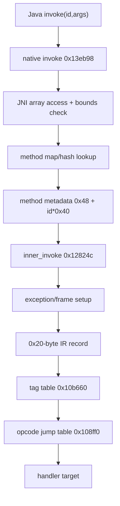

# Architecture

## Managed side

`VMPPBridge` exposes native calls for method invocation, string retrieval, and
initialization. The public analysis focuses on:

```text
VMPPBridge.invoke(int id, Object[] args)
VMPPBridge.decryptString(int id)
```

The integer passed to `invoke` is a method-table selector, not a native function
address, code offset, or opcode.

## Native side

| Ghidra address | Component | Evidence |
|---:|---|---|
| `0x138a58` | `JNI_OnLoad` | Native analysis; asset open/read, registration, parser |
| `0x13eb98` | invoke stub | JNI `Object[]` access, method bounds check, hash lookup |
| `0x12824c` | `inner_invoke` | exception/frame setup and IR dispatch |
| `0x1286b8` | dispatch | tag-dependent opcode field and relative jump table |
| `0x13f4ac` | `decryptString` | string-vector index and Java string construction |

Ghidra image base is `0x100000`; ELF-relative address = Ghidra address minus
`0x100000`.

## Container side

```text
magic + six (offset,count) pairs + reserved words
  ├─ method-code region 0x40 .. section0.offset
  ├─ section 0: 6,004 variable strings
  ├─ section 1: 677 class-table u32
  ├─ section 2: 353 exception vectors
  ├─ section 3: 937 three-word references
  ├─ section 4: 1,845 five-word method records
  └─ section 5: 22,118-byte unresolved blob
```

## Invoke flow (confirmed edges)



## String flow

`decryptString(id)` indexes a vector with `id < 6004` and constructs a Java
string. The VMP string records are decoded at parse/load time using XOR
`(byte_index & 0xA3)` plus modified UTF-8.

## What remains inferred

The native parser stores method records and code offsets, but the variable
method-code payload after the 16-byte header has not been converted to the IR
instruction stream. The dispatch mechanism is confirmed; the mapping from every
method ID to an opcode sequence is not.

See [native pipeline](../reports/phase11/native_execution_pipeline.md) and
[VMP format](../reports/phase11/vmp_format_reconstruction.md).
