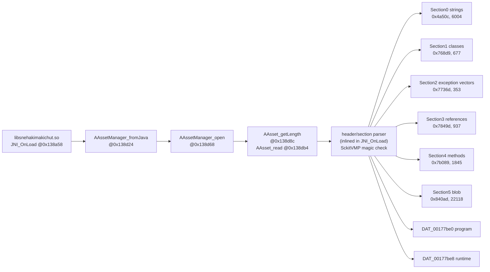

# Native call graph and evidence table

Ghidra image base `0x100000`; subtract `0x100000` for ELF-relative addresses.
This graph contains only edges demonstrated in the native disassembly or
decompilation. Edges marked UNRESOLVED are not drawn as proven calls.

## Initialization and data flow

The parser-to-section edges are established by the section boundary checks and
the data structures populated in `DAT_00177be0`; they are not generic claims
that every section is consumed by the interpreter.

## Registration and managed bridge

| Managed Java method | Native stub | Registration evidence | Notes |
|---|---:|---|---|
| `VMPPBridge.invoke(int,Object[])` | `0x13eb98` | slot 0 of 4-entry `RegisterNatives` table at `0x13ae44` | receives `jint`, `Object[]`; calls `inner_invoke` |
| `VMPPBridge.initApp(Object)` / `initApp2()` | `0x13f0a0` | slots 1 and 2 (same pointer) | exact name split is inferred, not decoded |
| `VMPPBridge.decryptString(int)` | `0x13f4ac` | slot 3 | indexes parsed string vector, returns jstring |
| `VMPPBridge.decrypt(byte[])` | not registered | absent from 4-entry table | no runtime use established |

## Invoke execution path

| Edge | Evidence | Confidence |
|---|---|---|
| `invoke` `0x13eb98` → `GetArrayLength` (`JNIEnv+0x558`) | disassembly at `0x13ec78`–`0x13ed14` | CONFIRMED |
| `invoke` → `GetObjectArrayElement` (`JNIEnv+0x568`) | loop at `0x13ecc8`–`0x13ed14` | CONFIRMED |
| `invoke` → bounds check against `DAT_00177be0+0x50` | `0x13ed2c`–`0x13ed58`; `Method index out of bounds` path | CONFIRMED |
| `invoke` → hash lookup `FUN_0012324c` | probes `DAT_00177be0+0x70/0x78/0x80` | CONFIRMED |
| `invoke` → method metadata `DAT_00177be0+0x48 + id*0x40` | parameter passed to `inner_invoke` at `0x13eed0` | CONFIRMED |
| `invoke` → `FUN_0012824c` (`inner_invoke`) | direct call at `0x13eed0` | CONFIRMED |
| `inner_invoke` → `FUN_001303d4` | call at `0x1282e8` in security-controlled branch | CONFIRMED edge; semantic role UNRESOLVED |
| `inner_invoke` → `FUN_0013057c` type resolution | call at `0x128544` | CONFIRMED |
| `inner_invoke` → `FUN_00123728` lookup builder | call at `0x128624` | CONFIRMED |
| `inner_invoke` → `0x1286b8` opcode dispatch | branch/jump table at `0x1286b8` | CONFIRMED |
| dispatch → 159 opcode handlers | 159 signed relative entries at `0x108ff0`; 116 unique targets | CONFIRMED |

## Opcode dispatch structure

| Item | Address/value | Evidence |
|---|---:|---|
| IR record size | `0x20` bytes | `x19 = code_base + ip*0x20`; fields at `+8,+10,+12,+14,+18,+1c` |
| Tag extraction | `qword0 ^ 0x8000000000000000`, capped at 14 | `0x12869c`–`0x1286ac` |
| Tag→opcode offset table | `0x10b660`, 16 qwords: `0c,08,0c,08,0e,08,08,0e,12,0e,08,10,10,08,1c,0c` | data table and `ldr x11,[x11,x10,lsl #3]` |
| Opcode u16 | `IR + tag_offset[tag]` | `ldrh w26,[x19,x11]` at `0x1286b0` |
| Jump-table base | `0x108ff0` | file/rodata table |
| Dispatch base | `0x1286b8` | `adr x12,0x1286b8` |
| Opcode count | 159 | `opcode-1` indexes table; parser rejects >0x9f |
| Unique handlers | 116 | extracted table |

The extracted per-opcode rows are in `data/opcode_dispatch.csv`.
No opcode is assigned a Java method name or a Java invocation ID.

## String path

| Edge | Evidence | Confidence |
|---|---|---|
| `decryptString` `0x13f4ac` → parsed string vector | reads count `[program+0x20]`, pointer `[program+0x18]`, 16-byte stride | CONFIRMED |
| `decryptString` → JNI string construction | calls `FUN_0013fd0c`/`NewStringUTF`-style helper and returns jobject | CONFIRMED behavior |
| VMP string record → text | `FUN_001313f4` XOR `(i & 0xA3)` + modified UTF-8 | CONFIRMED for all 6,004 records |

## Negative evidence

- No direct call edge from a Java invoke ID to an opcode was found. The ID is
  consumed by the method-table bounds check and hash lookup.
- No call edge from `RcIsRooted`, error code 500/900/300, or the
  `Please don't try to crack me!!!` literal to a VMP method was found in the
  static artifacts.
- `isPmsHooked` is in a different library, `libScKitShieldV1.so` at Ghidra
  `0x165e48`; it is not part of this VMP call graph.

---

*Public sanitized edition. Private raw artifacts, full inventories, and device/network identifiers are withheld; see `docs/publication-audit.md`.*
