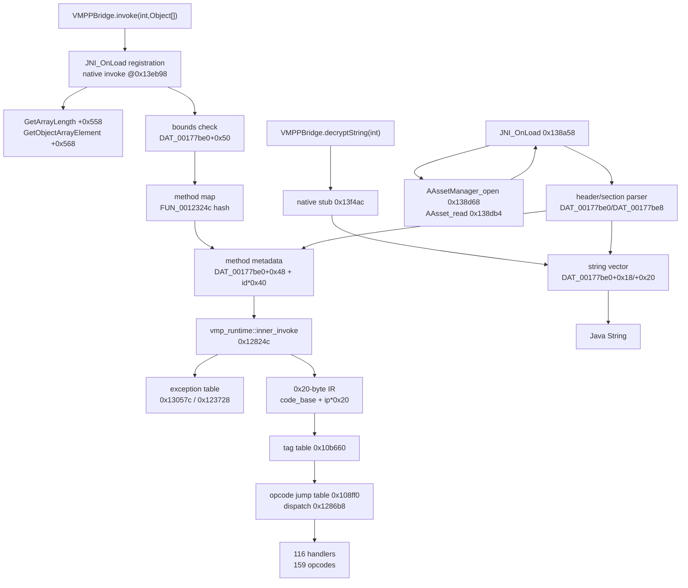

# Native execution pipeline

## Address convention

Ghidra 12.2 image base is `0x100000`. All addresses below are Ghidra addresses.
For `llvm-objdump`/ELF-relative addresses subtract `0x100000`; for example the
native `invoke` stub is Ghidra `0x13eb98` = ELF `0x3eb98`.

The library is AArch64, Rust, SHA-256
`091b06ee3cdf2ea3521a45542aebd25f60219484b93ae62ad204f5cc868da230`.

## 1. Load and registration

`JNI_OnLoad` at `0x138a58`:

1. Calls `FUN_00142ee4` at `0x138d08` with the literal `getAssets` and its JNI
   signature, then obtains the `AssetManager` with
   `AAssetManager_fromJava` at `0x138d24`.
2. Opens a VMP asset with `AAssetManager_open` at `0x138d68` and reads it with
   `AAsset_getLength`/`AAsset_read` at `0x138d8c`/`0x138db4`.
3. Verifies the 8-byte magic `SckitVMP`.
4. Parses the header/sections and fills the global VM structures. The principal
   globals are `DAT_00177be0` (program/container view) and `DAT_00177be8`
   (runtime state).
5. Registers four native methods in one `RegisterNatives` call at `0x13ae44`
   (`w3 = 4` at `0x13ae48`), using function pointers:

| Registration slot | Function pointer | Functional identification | Confidence |
|---:|---:|---|---|
| 0 | `0x13eb98` | `invoke(int, Object[])` | CONFIRMED: reads arg count/elements and method ID |
| 1 | `0x13f0a0` | `initApp`/`initApp2` body | PROBABLE: nullary initialization body; two registration slots share it |
| 2 | `0x13f0a0` | `initApp`/`initApp2` body | PROBABLE: same body as slot 1 |
| 3 | `0x13f4ac` | `decryptString(int)` | CONFIRMED behavior: indexes a 16-byte string vector and returns a Java string |

`VMPPBridge` declares five native methods (`decrypt(byte[])`,
`decryptString(int)`, `initApp(Object)`, `initApp2()`, `invoke(int,Object[])`),
but the registration table has four entries. `decrypt(byte[])` is not present in
that table; no evidence was recovered that it is used at runtime. This is a
registration fact, not a claim that the Java declaration is harmless.

Native function-pointer constants are copied from the decompiled registration
block at `JNI_OnLoad` lines corresponding to Ghidra `0x13ad60`–`0x13ae48`; the
four table entries are visible at `0x13ad88` (`0x13eb98`), `0x13ada8`/`0x13adb0`
(`0x13f0a0` twice), and `0x13adc8` (`0x13f4ac`).

## 2. `invoke`: method selection, not opcode selection

The `invoke` stub at `0x13eb98`:

1. Calls the JNI table entry at `+0x558` (`GetArrayLength`) and `+0x568`
   (`GetObjectArrayElement`) to materialize the `Object[]` argument list.
2. Reads the Java `int` ID into `param_3` (`w20` in the entry disassembly).
3. Bounds-checks the ID against `*(u64 *)(DAT_00177be0 + 0x50)`. The native
   error string is `Method index out of bounds`.
4. If a hash index exists (`DAT_00177be0 + 0x70 != 0`), hashes the ID with
   `FUN_0012324c`, probes the map, and obtains a method-map entry.
5. Takes the method metadata pointer from `DAT_00177be0 + 0x48` with a stride of
   `0x40`, plus the ID.
6. Allocates a frame/FX vector sized by fields from the map entry and calls
   `vmp_runtime::inner_invoke` at `0x12824c` with:
   - a local execution-context structure,
   - `JNIEnv*`,
   - the `method metadata` pointer,
   - the materialized argument vector.

The `Method index out of bounds` path and the `id * 0x40` indexing are direct
evidence that the Java invocation ID is a **method-table index**, not an opcode
or record byte offset. All 607 app IDs in
`private Phase X inventory (not published)` and all 117 log IDs in
`private Phase X log inventory (not published)` are in `0..1843`.

## 3. `inner_invoke`: exception setup and IR dispatch

`FUN_0012824c` at `0x12824c` (`crates/vmp_shell/src/vmp_runtime.rs` /
`inner_invoke.rs` strings are referenced there):

1. Verifies the argument vector length against a method-metadata field
   (`param_4[2] == *(u64 *)(param_3 + 0x18) + 1`). A mismatch throws the
   `inner_invoke.rs` framed error.
2. Builds an auxiliary byte vector from the method metadata (`param_3 + 0x10`).
3. Reads a method-indexed offset from the runtime state
   (`*(u32 *)(*(u64 *)(param_1 + 0x58) + 0x18)`), bounds-checks it against
   `DAT_00177be0 + 0x10`, and reads records from `DAT_00177be0 + 8`.
4. Builds an exception-handler table. For each handler entry it may call
   `FUN_0013057c` (`0x13057c`) to resolve a type, then builds a lookup map with
   `FUN_00123728` (`0x123728`).
5. Initializes thread-local execution state with `FUN_00140534`.
6. Uses `code_base = *(u64 *)(runtime + 8)`, `code_len = *(u64 *)(runtime + 0x10)`,
   and `ip = *(u64 *)(context + 0x60)`. Each decoded instruction is a **0x20-byte
   record** at `code_base + ip * 0x20`.

### Opcode dispatch

At `0x128698`–`0x1286c4`:

```asm
ldr   x8, [x19]                 ; first qword of the 0x20-byte IR record
eor   x9, x8, #0x8000000000000000
cmp   x9, #0x10
csel  x10, x9, #0xe, lo         ; tag 0..15, otherwise tag 14
ldr   x11, [tag_table + x10*8]  ; tag -> opcode-field byte offset
ldrh  w26, [x19, x11]           ; opcode
sub   w11, w26, #1
adr   x12, 0x1286b8
ldrsw x13, [jump_table + x11*4]
add   x12, x12, x13
br    x12
```

- IR record size: **0x20 bytes** (observed in `FUN_0012824c`; the parser also
  rejects `Invalid opcode value` outside the accepted range).
- Tag-dependent opcode-field offsets at Ghidra `0x10b660`:
  `[0x0c,0x08,0x0c,0x08,0x0e,0x08,0x08,0x0e,0x12,0x0e,0x08,0x10,0x10,0x08,0x1c,0x0c]`
  for tags 0–15.
- There are **159 opcode entries** (`1..159`). Opcode 0 or any value outside the
  table is invalid.
- The relative jump table is at Ghidra `0x108ff0`; the dispatch base is
  `0x1286b8`.
- The 159 entries resolve to **116 unique handler addresses** in
  `data/opcode_dispatch.csv`.

Representative handler families (address and duplicate opcode sets are
confirmed; semantic names are not):

| Handler | Opcodes | Observed handler operations | Confidence |
|---:|---|---|---|
| `0x1286c8` | 50–56 | Reads four u16 fields at `+8,+10,+12,+14`; calls `FUN_001275cc`, `FUN_0012f2a8`, `FUN_00127248`; invokes JNI `GetArrayLength` (`+0x558`) and `GetObjectArrayElement` (`+0x568`); calls `FUN_0012746c` | Address/group CONFIRMED; **JNI object-array handler family PROBABLE** |
| `0x128784` | 57–63 | Same operand layout family; calls `FUN_001275cc`, `FUN_00127248`; separate JNI path | Address/group CONFIRMED; **JNI object-array handler family PROBABLE** |
| `0x128834` | 64–70 | Shared seven-opcode handler | Address/group CONFIRMED; semantics UNRESOLVED |
| `0x128920` | 71–77 | Shared seven-opcode handler | Address/group CONFIRMED; semantics UNRESOLVED |
| `0x128af8` | 78–84 | Shared seven-opcode handler | Address/group CONFIRMED; semantics UNRESOLVED |
| `0x128a14` | 85–91 | Shared seven-opcode handler | Address/group CONFIRMED; semantics UNRESOLVED |
| `0x128bd4` | 92,93,94,96 | Shared handler; opcode 95 has its own target | Address/group CONFIRMED; semantics UNRESOLVED |

The seven-wide families are consistent with generated branch/opcode families
(the library contains `crates/vmp_shell/src/generated_branches.rs`), but no
Java-equivalent opcode names were assumed. The CSV records all 159 opcode
numbers and exact targets.

## 4. `decryptString`

The stub at `0x13f4ac`:

- When the alternate initialization flag is not set, reads
  `DAT_00177be0 + 0x20` as the string count and `DAT_00177be0 + 0x18` as the
  string-vector pointer.
- Rejects `id >= count` with `String index out of bounds`.
- Selects a 16-byte element at `pointer + id*0x10`; the first qword is the byte
  pointer and the second is the length (Rust `&str`/`String` layout).
- Constructs the Java string and returns it.

This is separate from `invoke`: `decryptString` IDs are in `0..6003` (the string
table), while `invoke` IDs are in `0..1844` (the method table). The Phase X
`decryptString(5148)` result matches string record 5148 exactly.

## 5. Call graph



## 6. Unresolved native questions

- The exact routine that converts the variable-length method-code payload into
  the 0x20-byte IR records was not isolated; the parser validates the code
  record header and IDs, but payload decoding is not yet proven.
- The semantic names of the 159 opcodes are not established. Only opcode/handler
  addresses and handler family groupings are confirmed.
- The four registered native names were inferred from the Java declarations and
  behavior; the generated registration-name strings were not independently
  decoded from the native initializer.
- `DAT_00177bb8`/runtime `+0x24` appears in a security-controlled branch of
  `inner_invoke`; its relationship to the observed 500/900/300 paths is not
  established.

---

*Public sanitized edition. Private raw artifacts, full inventories, and device/network identifiers are withheld; see `docs/publication-audit.md`.*
